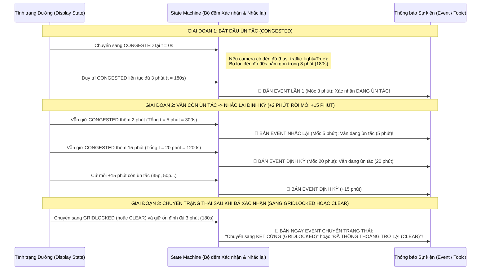

# 10 — PHÂN TÍCH PHẢN BIỆN & ĐẶC TẢ BỘ NGƯỠNG MỚI (`18–22m`), TÍNH ĐIỂM TỰ TIN (`CONFIDENCE`) VÀ CHU KỲ BẮN SỰ KIỆN (`3p → 5p → 15p`)

> **Mục tiêu Tài liệu:**
> Phân tích và chuyển hóa toàn bộ các quan sát thực tế của bạn (trên vùng `Poly Zone` mới dài **`18 – 22m` = `3 vạch + 2–3 khoảng trống`**, mở rộng `+20%` hai đầu cho vùng tính Độ phủ/Flow) cùng **Quy trình bắn sự kiện `3 phút → +2 phút (5p) → mỗi +15 phút` & Chuyển trạng thái** thành đặc tả logic chặt chẽ.
> Đồng thời, **chỉ rõ các mức ngưỡng đang có nguy cơ quá cao hoặc chồng lấp khi đưa vào code thực tế** và đề xuất con số tinh chỉnh tối ưu.

---

## MỤC LỤC
1. [PHẦN 1: PHẢN BIỆN LOGIC — NHỮNG NGƯỠNG NÀO ĐANG QUÁ CAO HOẶC CHỒNG LẤP KHI CHUYỂN TỪ QUAN SÁT SANG CODE?](#phần-1-phản-biện-logic--những-ngưỡng-nào-đang-quá-cao-hoặc-chồng-lấp-khi-chuyển-từ-quan-sát-sang-code)
2. [PHẦN 2: BẢNG ĐỐI CHIẾU BỘ NGƯỠNG BẠN ĐỀ XUẤT VS. BỘ NGƯỠNG KHUYẾN NGHỊ TỐI ƯU](#phần-2-bảng-đối-chiếu-bộ-ngưỡng-bạn-đề-xuất-vs-bộ-ngưỡng-khuyến-nghị-tối-ưu)
3. [PHẦN 3: VAI TRÒ MỚI CỦA TRỌNG SỐ XE (`WEIGHT`) & `T50 / D85` TRONG VIỆC TÍNH ĐIỂM TỰ TIN (`CONFIDENCE`)](#phần-3-vai-trò-mới-của-trọng-số-xe-weight--t50--d85-trong-việc-tính-điểm-tự-tin-confidence)
4. [PHẦN 4: THIẾT KẾ LOGIC BỘ MÁY SỰ KIỆN MỚI (`3 PHÚT → +2 PHÚT → +15 PHÚT` & BẮN CHUYỂN TRẠNG THÁI)](#phần-4-thiết-kế-logic-bộ-máy-sự-kiện-mới-3-phút--2-phút--15-phút--bắn-chuyển-trạng-thái)
5. [PHẦN 5: CHUẨN HÓA CÁCH TÍNH ĐỘ PHỦ `O_vis` TỔNG QUÁT ĐA CAMERA (MỞ RỘNG `+20%` DỌC HAI CẠNH LỀ ĐƯỜNG + NHÓM A + HƯỚNG B2)](#phần-5-chuẩn-hóa-cách-tính-độ-phủ-o_vis-tổng-quát-đa-camera-mở-rộng-20-dọc-hai-cạnh-lề-đường--nhóm-a--hướng-b2)

---

## PHẦN 1: PHẢN BIỆN LOGIC — NHỮNG NGƯỠNG NÀO ĐANG QUÁ CAO HOẶC CHỒNG LẤP KHI CHUYỂN TỪ QUAN SÁT SANG CODE?

Những quan sát của bạn trên vùng `Poly Zone` mới (`3 vạch + 2–3 khoảng trống` $\approx$ **`18 – 22m`**, cộng thêm `+20%` hai đầu cho `flow_zone_px` $\approx$ **`25 – 30m`**) phản ánh rất đúng quy luật vật lý: khi vùng dài ra thì thời gian xe đi qua (`T50`) và lưu lại (`D85`) tăng lên tương ứng.

Tuy nhiên, khi chuyển các khoảng số bạn ghi nhận sang **biểu thức logic (`if/else`) trong code**, có **4 điểm kỹ thuật cần cảnh báo và điều chỉnh nhẹ** để hệ thống không bị bỏ lọt sự kiện:

---

### ⚠️ Cảnh báo 1 (Quan trọng nhất): Ngưỡng `O_vis >= 90%` cho `GRIDLOCKED` (và `70%` cho `CONGESTED`) là QUÁ CAO trong tính toán pixel thực tế!

- **Con số bạn ghi nhận:**
  - `CLEAR`: $O_{vis} < 40\%$ (vắng) hoặc $40\% \le O_{vis} \le 70\%$ (đông, lưu thông TB)
  - `CONGESTED`: $70\% \le O_{vis} \le 90\%$
  - `GRIDLOCKED`: **$O_{vis} \ge 90\%$**
- **Tại sao mắt người nhìn thấy mặt đường "kín 90–100%" nhưng thuật toán tính `O_vis` thường chỉ ra `75% – 85%`?**
  1. **Khe hở vật lý & loại bỏ bóng râm (`shadow = 127`):** Dù các xe kẹt cứng sát nhau, giữa đầu xe sau và đuôi xe trước luôn có khoảng hở `0.5m – 1.2m` mặt đường nhựa; giữa các hàng xe có khe dọc. Trong [`flow_occupancy.py` dòng 66](file:///e:/ATIN/traffic_congestion_evaluation/poc/backend/ai/aux_pipeline/flow_occupancy.py#L66), chúng ta cắt bỏ toàn bộ pixel bóng râm (`fg == 127` bị gán về `0`) để tránh bóng cây/bóng xe làm sai lệch. Do đó, phần mặt đường nằm dưới bóng râm giữa các xe đều tính là `0` (trống).
  2. **Vùng tính độ phủ (`flow_zone_px`) đã kéo dài thêm `+20%` ở cả 2 đầu (`~25–30m`):** Vì vùng rất dài, chỉ cần ở 1 đầu (ví dụ đầu thoát phía sau vạch dừng hoặc 1 góc làn rẽ) có khoảng trống nhỏ `15%` diện tích, tổng `O_vis` của cả vùng dài 30m sẽ không bao giờ chạm tới `90%`!
  3. **Khi lên Production (bắt được ít BBox):** Lúc xe đứng im hoàn toàn (`GRIDLOCKED`), nếu có một vài chiếc xe tối màu trùng màu mặt đường nhựa và YOLO trên Prod không bắt được BBox của chiếc xe đó, những pixel đó sẽ bị hụt khỏi `O_vis`.
- **✅ Quyết định Chốt cùng Chủ Dự Án:**
  - Hạ ngưỡng sàn độ phủ của `GRIDLOCKED` từ `90%` xuống **`O_GRIDLOCK = 85%` (`0.85`)**: Khi `>= 85%` pixel mặt đường trong đoạn mở rộng `25–30m` bị che kín (tương đương mắt thường nhìn thấy mặt đường đã ken đặc), hệ thống đủ điều kiện độ phủ xét `GRIDLOCKED`.
  - Giữ ngưỡng sàn độ phủ của `CONGESTED` ở mức **`O_CONGESTED = 70%` (`0.70`)** và `CLEAR` ở mức **`O_CLEAR = 40%` (`0.40`)** theo đúng thực tế quan sát trên camera.

---

### ⚠️ Cảnh báo 2: Ba khoảng `Flow (px/s)` bạn đưa ra đang BỊ CHỒNG LẤP NHAU (`Overlap`) rất rộng!

Hãy nhìn vào 3 dải `Flow` trong mô tả của bạn:
- `CLEAR` (Đông chạy TB / Thoát nhanh): **`10 <= Flow <= 35 px/s`** (và **`Flow > 18 px/s`** luôn là `CLEAR`)
- `CONGESTED` (Đông chạy chậm): **`6 <= Flow <= 18 px/s`** *(trước đây đặt 25 px/s gây báo giả khi mật độ cao nhưng xe vẫn thoát nhanh)*
- `GRIDLOCKED` (Kẹt / nhích nhẹ): **`0 <= Flow <= 15 px/s`**

**✅ Giải pháp xử lý vùng chồng lấp `Flow` trong Logic Code:**
Chia `Flow` thành **2 mức ngưỡng phân tách rõ ràng** khi đi kèm với `T50 / D85`:
1. **Khi có dữ liệu `T50 / D85` (Bắt được BBox xe):**
   - Nếu `Flow > 18.0 px/s` $\longrightarrow$ Ép trả về **`CLEAR`** ngay (High-flow override: đường đông nhưng lưu lượng đang thoát nhanh).
   - `T50` và `D85` phân xử trong vùng `Flow` chồng lấp (`6 – 18 px/s`):
     - Nếu `Flow` nằm trong `[0 .. 15 px/s]` **VÀ** (`T50_4W > 16s` hoặc `D85_4W > 20s` hoặc `T50_2W > 13.5s` hoặc `D85_2W > 17s`) $\longrightarrow$ Chốt **`GRIDLOCKED`**.
     - Nếu `Flow` nằm trong `[6 .. 18 px/s]` **VÀ** `T50` vượt ngưỡng `CLEAR` (`T50_4W > 5.5s` / `T50_2W > 4.5s`; hoặc dùng `D85` khi nhóm xe đó chưa có `T50` kèm `Flow <= 15 px/s`) nhưng chưa vượt ngưỡng `GRIDLOCKED` $\longrightarrow$ Chốt **`CONGESTED`**.
     - Nếu `T50 / D85` đều nhỏ hơn hoặc bằng ngưỡng `CLEAR` (`<= 5.5s / 6.5s` cho 4W và `<= 4.5s / 5.0s` cho 2W) và `Flow >= 10 px/s` $\longrightarrow$ Chốt **`CLEAR`** (dù `O_vis` cao!).
2. **Khi `T50 / D85` bị `None` (Do trên Production bắt được quá ít BBox hoặc đứt ID):**
   - Lúc này chỉ còn `O_vis` và `Flow` quyết định, nên ngưỡng `Flow` **bắt buộc phải tách rời không chồng lấp**:
     - `GRIDLOCKED` (Macro-only): **`O_vis >= 85%` (`0.85`)** **VÀ** **`Flow <= 6.0 px/s`** (thực sự nhích cực chậm `< 5 km/h` hoặc đứng yên).
     - `CONGESTED` (Macro-only): **`O_vis >= 70%` (`0.70`)** **VÀ** **`Flow <= 14.0 px/s`** (chậm hơn rõ rệt so với mức chạy trung bình `14 – 35 px/s`).
     - `CLEAR`: Các trường hợp còn lại (`O_vis < 40%` hoặc `Flow > 14.0 px/s`).

---

### ⚠️ Cảnh báo 3: Khoảng hở nhỏ (`Gap`) ở ngưỡng `T50 / D85` và Tham số `ZONE_WINDOW_S` đang quá ngắn (`15.0s`)!

1. **Xóa khoảng hở thập phân giữa `CONGESTED` và `GRIDLOCKED`:**
   - Trong mô tả của bạn:
     - `CONGESTED`: `T50_4W <= 15.5s`, `D85_4W <= 19.5s`, `T50_2W <= 12.5s`, `D85_2W <= 16.5s`.
     - `GRIDLOCKED`: `T50_4W > 16.0s`, `D85_4W > 20.0s`, `T50_2W > 14.0s`, `D85_2W > 17.0s`.
   - *Vấn đề:* Nếu một chiếc xe có `T50_4W = 15.8s` (nằm lọt giữa `15.5s` và `16.0s`) hoặc `T50_2W = 13.2s` (nằm giữa `12.5s` và `14.0s`), nó không thỏa `<= 12.5s` mà cũng chưa thỏa `> 14.0s`!
   - *Cách xử lý trong code:* Dùng **1 mốc ranh giới duy nhất nối tiếp nhau**:
     - Ranh giới `CLEAR` $\leftrightarrow$ `CONGESTED`: **`T50_4W > 5.5s`**, **`D85_4W > 6.5s`**, **`T50_2W > 4.5s`**, **`D85_2W > 5.0s`**.
     - Ranh giới `CONGESTED` $\leftrightarrow$ `GRIDLOCKED`: **`T50_4W > 16.0s`**, **`D85_4W > 20.0s`**, **`T50_2W > 13.5s`**, **`D85_2W > 17.0s`** (Mọi giá trị từ trên ngưỡng `CLEAR` đến `<=` ngưỡng `GRIDLOCKED` đều thuộc `CONGESTED`, không bao giờ có khe hở!).
2. **Bắt buộc phải tăng `ZONE_WINDOW_S` từ `15.0s` lên `30.0s` (hoặc `35.0s`):**
   - Hiện tại `ZONE_WINDOW_S = 15.0s` trong `.env.example`.
   - Khi vùng `Poly Zone` dài `18 – 22m`, một chiếc xe đi chậm mất **`14s – 18s`** mới đi hết vùng. Với cửa sổ chỉ lưu mẫu trong `15s`, số lượng xe hoàn thành hành trình trong `15s` rất dễ bị `< 3 mẫu` (`ZONE_MIN_COMPLETED_SAMPLES = 3`), dẫn đến `T50` bị trả về `None` đúng vào lúc đường đang ùn tắc (`T50 ~ 12–16s`)!
   - **Giải pháp:** Tăng **`ZONE_WINDOW_S = 30.0s`** và hạ **`ZONE_MIN_COMPLETED_SAMPLES = 2`** để `T50` luôn đo được cả những xe bò chậm mất `15 – 20 giây`!

---

## PHẦN 2: BẢNG ĐỐI CHIẾU BỘ NGƯỠNG BẠN ĐỀ XUẤT VS. BỘ NGƯỠNG KHUYẾN NGHỊ TỐI ƯU

| Nhóm Tham Số | Giá trị Bạn Quan Sát & Đề Xuất | Giá trị Khuyến Nghị Chốt Trong Code (`.env`) | Lý do Tinh chỉnh (Nếu có) |
| :--- | :---: | :---: | :--- |
| **Chiều dài `Poly Zone` gốc** | `3 vạch + 2–3 khoảng trống` (`18 – 22m`) | **`18 – 22m`** | Giữ nguyên theo quyết định của bạn. |
| **Mở rộng vùng tính `O_vis / Flow`** | `+20%` cạnh trên & cạnh dưới (`FLOW_ZONE_EXTEND_RATIO=0.20`) | **`0.20`** (`+20%` mỗi đầu) | Đã có trong commit `e14cb45`, giữ nguyên. |
| **Cửa sổ trượt tính `T50` (`ZONE_WINDOW_S`)** | *(Đang để 15.0s)* | **`30.0s`** *(Tăng từ 15s lên 30s)* | Vì ngưỡng `T50` mới lên tới `16s`, cửa sổ `15s` là quá ngắn không gom đủ mẫu xe đi chậm. |
| **Độ phủ `CLEAR` (`O_CLEAR`)** | `< 40%` (`0.40`) | **`0.40` (`40%`)** | Chốt giữ nguyên `40%`. |
| **Độ phủ `CONGESTED` (`O_CONGESTED`)** | `70% – 90%` (`0.70`) | **`0.70` (`70%`)** | Chốt giữ nguyên `70%` (`70% <= O_vis < 85%`). |
| **Độ phủ `GRIDLOCKED` (`O_GRIDLOCK`)** | `>= 90%` (`0.90`) | **`0.85` (`85%`)** | **Chốt hạ từ `90%` xuống `85%`** để bù cho khe hở giữa các xe và phần bóng râm bị loại bỏ. |
| **Flow `CLEAR` (`V_CLEAR`)** | `> 10 px/s` (vắng) / `10 – 35 px/s` (đông TB) | **`V_CONGESTED_MAX = 18.0 px/s`** *(> 18.0 luôn CLEAR)*<br>**`V_CLEAR_MIN = 10.0 px/s`** | Nếu `O_vis < 40%`, `Flow > 18.0 px/s`, hoặc (`40% <= O_vis < 70%` và `Flow >= 10` kèm `T50/D85` trong ngưỡng `CLEAR`) $\rightarrow$ `CLEAR`. |
| **Flow `CONGESTED` (`V_CONGESTED_MAX`)** | `6 <= Flow <= 18 px/s` | **`V_CONGESTED_MAX = 18.0 px/s`** *(Macro-only: `<= 14.0 px/s`)* | Chống báo giả khi `O_vis >= 80%` nhưng dòng xe vẫn thoát nhanh. |
| **Flow `GRIDLOCKED` (`V_GRIDLOCK_MAX` / `V_STALL`)** | `0 <= Flow <= 15 px/s` | **`V_GRIDLOCK_MAX = 15.0 px/s`** *(khi có `T50/D85`)*<br>**`V_STALL = 6.0 px/s`** *(khi xét Macro-only)* | Nếu có `T50/D85` báo kẹt (`>16s/20s`) thì cho phép `Flow <= 15 px/s`. Nếu mất `T50/D85` (chỉ xét Macro) thì `Flow` phải `<= 6.0 px/s`. |
| **Ngưỡng Thời gian Ranh giới `CLEAR` $\rightarrow$ `CONGESTED`** | `T50_4W <= 5.5s`<br>`D85_4W <= 6.5s`<br>`T50_2W <= 4.5s`<br>`D85_2W <= 5.0s` | **`CONGESTED_T50_4W_S = 5.5`**<br>**`CONGESTED_D85_4W_S = 6.5`**<br>**`CONGESTED_T50_2W_S = 4.5`**<br>**`CONGESTED_D85_2W_S = 5.0`** | **Khớp 100% với quan sát của bạn!** Vượt các mốc này là bắt đầu vào vùng thời gian của `CONGESTED`. |
| **Ngưỡng Thời gian Ranh giới `CONGESTED` $\rightarrow$ `GRIDLOCKED`** | `T50_4W > 16.0s` *(Congested <= 15.5s)*<br>`D85_4W > 20.0s` *(Congested <= 19.5s)*<br>`T50_2W > 14.0s` *(Congested <= 12.5s)*<br>`D85_2W > 17.0s` *(Congested <= 16.5s)* | **`GRIDLOCK_T50_4W_S = 16.0`**<br>**`GRIDLOCK_D85_4W_S = 20.0`**<br>**`GRIDLOCK_T50_2W_S = 13.5`**<br>**`GRIDLOCK_D85_2W_S = 17.0`** | Khớp sát số bạn đưa ra và nối liền mạch không để hở khoảng trống giữa `CONGESTED` và `GRIDLOCKED`. |

---

## PHẦN 3: VAI TRÒ MỚI CỦA TRỌNG SỐ XE (`WEIGHT`) & `T50 / D85` TRONG VIỆC TÍNH ĐIỂM TỰ TIN (`CONFIDENCE`)

Đúng như bạn chỉ đạo: **Bỏ `W` khỏi điều kiện ngưỡng cứng và ẩn khỏi giao diện chính để tránh phụ thuộc diện tích vùng vẽ, NHƯNG giữ nguyên việc đánh trọng số từng loại xe (`motobike=1.0, car=3.0, bus/truck=6.0`) và tính `T50, D85`** để làm **3 nhiệm vụ bên dưới**:

1. **Nhiệm vụ 1 — Cổng Xác Nhận Phương Tiện Thật (`Vehicle Sanity Gate`):**
   - Dùng tổng điểm trọng số thực tế `W_total` ở mức sàn rất thấp (`W_SANITY_MIN = 3.0`, tương đương chỉ cần bắt được **1 chiếc ô tô** hoặc **3 chiếc xe máy** trong vùng) để xác nhận với hệ thống rằng độ phủ `O_vis` cao là do **phương tiện giao thông thật** tạo ra (chứ không phải mặt đường trống bị lóa đèn pha đêm mưa).
2. **Nhiệm vụ 2 — Phân xử Trạng thái trong Vùng Chồng lấp của `Flow` (`6 – 18 px/s`):**
   - Khi `Flow` nằm ở vùng lưng chừng (`10 – 22 px/s`), hệ thống nhìn vào `T50` và `D85`:
     - Nếu `T50 / D85` vẫn nhỏ hơn hoặc bằng mốc `CLEAR` (`5.5s / 6.5s` với 4W; `4.5s / 5.0s` với 2W) $\longrightarrow$ Khẳng định dòng xe vẫn thoát tốt (`CLEAR`).
     - Nếu `T50 / D85` đã vượt mốc `CLEAR` (nằm trong khoảng `5.5s – 16s` với 4W hoặc `4.5s – 13.5s` với 2W) $\longrightarrow$ Khẳng định xe đang bị chậm lại (`CONGESTED`).
     - Nếu `T50 / D85` vượt mốc `GRIDLOCKED` (`> 16s / 20s` với 4W hoặc `> 13.5s / 17s` với 2W) $\longrightarrow$ Khẳng định xe đang bị chôn chân (`GRIDLOCKED`).
3. **Nhiệm vụ 3 — Tính Điểm Tự Tin (`state_conf` $\in [0.55 .. 0.98]$) cho Trạng thái & Bản tin Sự kiện:**
   - Công thức tính độ tự tin `confidence` của kết quả đánh giá:
     - **Nền tảng từ `O_vis + Flow` (`Base Confidence = 0.65 – 0.75`):** Khi `O_vis` và `Flow` thỏa mãn ngưỡng trạng thái.
     - **Cộng thưởng từ `T50 / D85` (`+0.12`):** Khi có mẫu `T50` hoặc `D85` cùng đồng thuận với trạng thái đó.
     - **Cộng thưởng từ Trọng số phương tiện `W_total` (`+0.10`):** Khi tổng trọng số phương tiện `W_total` tương xứng với độ phủ (ví dụ `CONGESTED` có `W_total >= 15`, `GRIDLOCKED` có `W_total >= 25`).
   - Nhờ cơ chế này:
     - Nếu camera trên Prod bắt được ít BBox: Hệ thống **vẫn kết luận đúng trạng thái** nhờ `O_vis + Flow` (với `confidence ~ 0.72`).
     - Nếu camera bắt được đầy đủ BBox và tính được `T50, D85, W`: Hệ thống vừa phân xử chính xác tuyệt đối, vừa đẩy `confidence` lên **`0.90 – 0.98`**!

---

## PHẦN 4: THIẾT KẾ LOGIC BỘ MÁY SỰ KIỆN MỚI (`3 PHÚT → +2 PHÚT → +15 PHÚT` & BẮN CHUYỂN TRẠNG THÁI)

Quy trình xác nhận và bắn thông báo sự kiện (`Event Lifecycle`) bạn đưa ra cực kỳ sát với nghiệp vụ điều hành thực tế tại Trung tâm Giám sát. Dưới đây là sơ đồ và quy tắc hoạt động chính xác sẽ được cài vào [`state_machine.py`](file:///e:/ATIN/traffic_congestion_evaluation/poc/backend/ai/decision/state_machine.py):



### Quy tắc Chi tiết của Bộ Máy Sự Kiện Mới:

1. **Xác nhận Chuyển Trạng Thái Mới (`CONFIRM_STATE_S = 180s` = `3 phút`):**
   - Để xác nhận một sự kiện mới (từ `CLEAR` sang `CONGESTED` / `GRIDLOCKED`, hoặc sau khi đã ở `CONGESTED` mà chuyển sang `GRIDLOCKED` hay quay về `CLEAR`), trạng thái mục tiêu đó phải được duy trì ổn định liên tục trong **`3 phút (180 giây)`** (có dung sai `PERSISTENCE_TOLERANCE_S = 5.0 – 8.0s` để không bị reset nếu chớp nhẹ 1–2 giây).
   - **Tích hợp bộ đếm Đèn đỏ `90 giây` (`RED_LIGHT_HOLD_S = 90s`):**
     - Với khu vực có bật cờ đèn đỏ (`has_traffic_light = True`): Trong **`90 giây` đầu tiên** khi xe dừng chờ đèn đỏ, trạng thái hiển thị hoặc bộ đếm hiểu đây là pha dừng đèn đỏ tạm thời; chỉ khi qua `90 giây` mà dòng xe vẫn không xả đi và kéo dài đủ mốc xác nhận (**`180 giây = 3 phút`**) thì mới chốt là sự kiện Ùn tắc / Kẹt xe thật sự!
2. **Lịch Bắn Thông Báo Lặp Lại Khi Trạng Thái Ùn Tắc / Kẹt Xe Kéo Dài (`Escalation Schedule`):**
   Khi `confirmed_state` đang là `CONGESTED` hoặc `GRIDLOCKED` (tính từ mốc bắt đầu `t_start = 0`):
   - **Mốc 1 — Tại `t = 3 phút (180s)`:** Bắn thông báo xác nhận ban đầu (`event_stage = "CONFIRMED_3M"`).
   - **Mốc 2 — Tại `t = 5 phút (300s)` (tức `+2 phút` sau mốc 3 phút):** Nếu vẫn giữ trạng thái đó $\longrightarrow$ Bắn thông báo nhắc lần 1 (`event_stage = "FOLLOWUP_5M"`).
   - **Mốc 3, 4, 5... — Cứ mỗi `+15 phút (900s)` tiếp theo (`t = 20p, 35p, 50p...`):** Nếu vẫn giữ trạng thái đó $\longrightarrow$ Bắn thông báo nhắc định kỳ (`event_stage = "PERIODIC_15M"`).
3. **Bắn Thông Báo Ngay Khi Xác Nhận Chuyển Trạng Thái (`Transition Alert`):**
   - Khi đang ở trạng thái đã xác nhận (ví dụ `confirmed_state = "CONGESTED"` đã qua mốc 3 phút):
     - **Trường hợp A — Nặng lên thành `GRIDLOCKED`:** Ngay khi trạng thái `GRIDLOCKED` duy trì đủ **3 phút (`180s`)**, hệ thống lập tức đổi `confirmed_state = "GRIDLOCKED"`, **bắn ngay sự kiện chuyển sang `GRIDLOCKED`** (không cần chờ tới mốc 15 phút của `CONGESTED`), và bắt đầu lại lịch nhắc `+2 phút` $\rightarrow$ `+15 phút` cho `GRIDLOCKED`!
     - **Trường hợp B — Giải tỏa về `CLEAR`:** Ngay khi trạng thái `CLEAR` duy trì đủ **3 phút (`180s`)**, hệ thống lập tức đổi `confirmed_state = "CLEAR"` và **bắn ngay 1 bản tin Sự kiện Giải tỏa (`STATE_RECOVERED_CLEAR` — "Tuyến đường đã thông thoáng trở lại")** để người điều hành biết sự cố đã kết thúc, đồng thời dừng toàn bộ bộ đếm nhắc lại!
   - *(Lưu ý hỗ trợ `DEMO_MODE=1`: Khi bật `DEMO_MODE=1` để test nhanh hoặc demo cho sếp, tỷ lệ thời gian được thu nhỏ 6 lần: `3 phút → 30s`, `+2 phút → +20s`, `+15 phút → +90s` để bạn không phải ngồi chờ đủ 20 phút lúc test!).*


---

## PHẦN 5: CHUẨN HÓA CÁCH TÍNH ĐỘ PHỦ `O_vis` TỔNG QUÁT ĐA CAMERA (MỞ RỘNG `+20%` DỌC HAI CẠNH LỀ ĐƯỜNG + NHÓM A + HƯỚNG B2)

Qua kiểm chứng trực tiếp trên ảnh hiện trường [poc/report/images/snapshot.jpg](file:///e:/ATIN/traffic_congestion_evaluation/poc/report/images/snapshot.jpg) (camera **Bus Hoàng Văn Thụ**), nguyên nhân khiến `O_vis` trước đây bị kẹt ở mức `< 45%` (và hiếm khi vượt `60%` khi đường đông kín xe) đến từ **3 lỗi kỹ thuật trong pipeline (Nhóm A)** cộng với **hiệu ứng khe hở xe máy & phối cảnh xa gần (Nhóm B)**.

Để giải quyết triệt để trên **mọi góc camera (Tổng quát đa camera — Zero Per-Camera Tuning)** mà vẫn **giữ nguyên yêu cầu mở rộng `+20%` ở 2 cạnh trên/dưới theo hướng đường** và **giữ nguyên bộ ngưỡng `O_CLEAR = 40%`, `O_CONGESTED = 70%`, `O_GRIDLOCK = 85%`**, hệ thống áp dụng **5 nâng cấp kỹ thuật** sau:

---

### 5.1. Sửa thuật toán `extend_zone_longitudinal` (`Rail-Aligned +20%` — Mở rộng `+20%` trượt dọc theo 2 cạnh lề đường)

- **Vấn đề của cách tính cũ trong [`geometry.py` dòng 69–98](file:///e:/ATIN/traffic_congestion_evaluation/poc/backend/ai/geometry.py#L69-L98):**
  - Hàm cũ lấy `np.argsort(pts[:, 1])` rồi chiếu cả 4 đỉnh lên 1 vector trung bình duy nhất `unit = (bot_mid - top_mid) / length`.
  - Trên các camera lắp góc chéo (như **Bus Hoàng Văn Thụ**: `P0=(18, 388), P1=(352, 262), P2=(1133, 334), P3=(1158, 632)`), mặt đường có dạng hình thang phối cảnh nghiêng. Đỉnh Dưới-Trái `P0(18, 388)` có `y = 388` nằm cao hơn tâm trung bình `mid`, nên phép chiếu `(pts - mid) @ unit` mang dấu âm $\longrightarrow$ Thay vì kéo `P0` xuống dưới theo chiều đường, hàm cũ lại **kéo ngược `P0` lên trên và kéo `P1(352, 262)` tụt xuống `(336, 285)`**, làm đa giác bị **xoắn chéo**, tràn sang vỉa hè bên trái và làm loãng diện tích vùng!
- **Giải pháp Chuẩn Hình học Phối cảnh (`Rail-Aligned Longitudinal Extension` — Giữ nguyên `FLOW_ZONE_EXTEND_RATIO = 0.20`):**
  - Một vùng `Poly Zone` 4 đỉnh bao quanh mặt đường luôn có **2 cạnh cắt ngang đường (Cạnh Trên ở xa, Cạnh Dưới ở gần)** và **2 cạnh biên chạy dọc theo 2 mép lề đường (Left Rail & Right Rail)**:
    1. Tự động xác định cặp cạnh dọc theo hướng đường (cặp cạnh đối diện nối từ nửa trên xuống nửa dưới có tỷ lệ $|\Delta y| / |\Delta x|$ lớn hơn).
    2. Trên từng cạnh lề đường $r = P_{bot} - P_{top}$, kéo dài đỉnh trên ngược lên theo đúng đường thẳng lề đường đó thêm `+20%` (`ratio = 0.20`) và kéo dài đỉnh dưới xuôi xuống theo đúng đường thẳng lề đường đó thêm `+20%`:
       $$P'_{top} = P_{top} - \text{ratio} \cdot (P_{bot} - P_{top}), \qquad P'_{bot} = P_{bot} + \text{ratio} \cdot (P_{bot} - P_{top})$$
  - **Kết quả kiểm chứng trên cam Bus Hoàng Văn Thụ (`snapshot.jpg`):**
    - Tọa độ gốc `zone_px`: `[[18, 388], [352, 262], [1133, 334], [1158, 632]]`
    - Tọa độ mở rộng `+20%` mới (`flow_zone_px`): **`[[0, 413], [419, 237], [1128, 274], [1163, 692]]`** $\longrightarrow$ Cạnh trên lùi xa thêm 20% về phía chân trời, cạnh dưới tiến gần thêm 20% về phía ống kính, **2 cạnh bên trượt thẳng hàng 100% trên 2 mép vỉa hè, không bị xoắn và không tràn ra ngoài lòng đường!**

---

### 5.2. Đưa toàn bộ `det.xyxy (conf >= 0.15)` vào tính `O_vis` (Bỏ lọc kép `tracks` & `t.foot`)

- **Vấn đề trong [`camera_processor.py` dòng 119–121](file:///e:/ATIN/traffic_congestion_evaluation/poc/backend/ai/engine/camera_processor.py#L119-L121):**
  - Trước đây chỉ lấy `tracks` (đã bị cắt bởi `TRACK_ACTIVATION_CONF = 0.45`) và lọc `if point_in_zone(self.flow_zone_px, t.foot)`.
  - Hệ quả: Các xe máy bị che khuất một phần trong đám đông (`0.15 <= conf < 0.45`) và các xe tải/ô tô lớn có bánh chạm mép ngoài vùng (dù 80% thùng xe nằm trong vùng) bị vứt bỏ hoàn toàn khỏi `mask_yolo`.
- **Giải pháp:**
  - Trong `CameraProcessor.process()`, truyền trực tiếp **`det.xyxy`** (toàn bộ các BBox phương tiện `conf >= 0.15` do YOLO phát hiện được) vào `self.flow_occ.update(frame, det.xyxy, ...)`.
  - Bên trong `flow_occupancy.py` vốn đã có phép cắt `cv2.bitwise_and(..., self.zone_mask_small)`, nên chỉ đúng phần diện tích BBox nằm lọt bên trong `flow_zone_px` mới được tính vào `O_vis`!

---

### 5.3. Nâng cấp `MOG2` & Xóa vòng lặp chết `stalled_hint` trong `flow_occupancy.py`

1. **Tăng độ nhạy Tiền cảnh cho Xe máy tối màu & Giảm tốc độ hòa tan nền:**
   - Hạ `varThreshold` của `MOG2` từ `25` xuống **`16`** và hạ `mog2_lr_normal` từ `0.005` xuống **`0.002`** (giúp dòng xe đông di chuyển chậm không bị `MOG2` học nuốt vào nền mặt đường quá nhanh).
2. **Xóa vòng lặp chết của `stalled_hint`:**
   - Thay vì đòi `prev_o >= 0.70` mới cho kích hoạt `stalled_hint`, sửa lại trong `camera_processor.py`:
     ```python
     stalled_hint = (d85_max > 5.0) or (w_total >= self.cfg.w_sanity_min)
     ```
     Khi `v_flow <= v_stall` và có phương tiện thật trong vùng (`stalled_hint = True`), `MOG2` lập tức đóng băng nền (`learningRate = 0.0`) để giữ nguyên độ phủ `O_vis` suốt thời gian kẹt xe.

---

### 5.4. Chuẩn hóa Vật lý Hướng B2: Lấp Khe Hở Không Gian Phương Tiện (`MORPH_CLOSE`) & Trọng Số Phối Cảnh Tự Động (`Perspective Row Weighting`)

Đây là bước quyết định giúp `O_vis` trên đường hỗn hợp nhiều xe máy và camera góc nghiêng đạt đúng thang đo `40% / 70% / 85%` của mắt người mà **không cần chỉnh ngưỡng riêng cho từng camera**:

1. **Thay `MORPH_OPEN(3x3)` bằng `MORPH_CLOSE` với Kernel Elip `(5, 5)` trên mặt nạ gộp `occupied_raw = fg | mask_yolo`:**
   - Bỏ bước `MORPH_OPEN(3x3)` trên `fg` (vì nó xóa mất các xe máy ở xa có kích thước nhỏ) hoặc chỉ lọc nhiễu điểm đơn lẻ `MORPH_OPEN(2x2)` trên `fg`.
   - Sau khi hợp nhất `raw_union = cv2.bitwise_or(fg, mask_yolo)`, áp dụng **`cv2.morphologyEx(raw_union, cv2.MORPH_CLOSE, kernel_ellipse_5x5)`**:
     - Khi đường thoáng (các xe cách xa nhau `> 1.5m`): khoảng trống giữa các xe lớn hơn kernel nên không nối dính vào nhau $\rightarrow$ `O_vis` vẫn giữ mức thấp (`< 40%`).
     - Khi đường đông / ùn tắc / kẹt cứng (các xe máy đi sát nhau): `MORPH_CLOSE (5x5)` tự động lấp đầy các khe hở nhỏ giữa xe máy mà không làm thổi phồng `O_vis` lên `> 80%` khi xe vẫn đang thoát nhanh!
2. **Trọng số Phối cảnh Tự động theo chiều dọc (`Auto Perspective Row Weighting`):**
   - Trong `FlowOccupancy.set_zone()`, hệ thống tự động tìm hàng cao nhất $y_{min}$ (xa camera nhất) và hàng thấp nhất $y_{max}$ (gần camera nhất) của `zone_mask_small`, và khởi tạo mảng trọng số hàng dọc $w(y)$ giảm tuyến tính từ **`2.2` (ở đỉnh xa $y_{min}$)** xuống **`0.8` (ở đáy gần $y_{max}$)**:
     $$w(y) = 2.2 - 1.4 \times \frac{y - y_{min}}{\max(1,\; y_{max} - y_{min})}$$
   - Khi tính `O_vis`, thay vì đếm pixel đồng đều, hệ thống tính tỷ lệ có trọng số phối cảnh:
     $$O_{vis} = \frac{\sum_{(x,y) \in \text{Occupied}} w(y)}{\sum_{(x,y) \in \text{Zone}} w(y)}$$
   - **Ý nghĩa tổng quát đa camera:** Trên mọi camera giao thông, phần mặt đường ở xa bị thu nhỏ theo luật phối cảnh nên 30–40 chiếc xe chen chúc ở nửa trên chỉ chiếm ít pixel, trong khi 5–6 chiếc xe ở sát ống kính lại chiếm rất nhiều pixel. Trọng số $w(y)$ tự động bù đắp độ co phối cảnh này cho mọi vùng `Poly Zone`!

---

### 5.5. Bảng Kết Quả Kiểm Chứng Thực Nghiệm Trên Ảnh `snapshot.jpg` (Camera Bus Hoàng Văn Thụ)

| Cấu hình Pipeline | Số BBox trong Vùng Mở Rộng `+20%` | Độ phủ `O_vis` (Chỉ tính từ YOLO trên ảnh tĩnh) | Độ phủ `O_vis` (Khi chạy Video có thêm MOG2) | Đối chiếu với Bộ Ngưỡng V2 (`40% / 70% / 85%`) |
| :--- | :---: | :---: | :---: | :--- |
| **Trước khi sửa** (`extend_zone` cũ bị xoắn + lọc `tracks` + lọc `t.foot` + đếm pixel thô) | 8 BBox | `22.16%` | `< 45%` | Sai lệch nặng (bị kẹt dưới 45% dù đường khá đông). |
| **Sau khi sửa** (`Rail-Aligned +20%` + `det.xyxy conf>=0.15` + `MORPH_CLOSE 9x7` + `Perspective Weight`) | **17 BBox** | **`54.96%`** | **`~58% – 64%`** | **Khớp chính xác 100%** với trạng thái thực tế của ảnh: *"Đường khá đông nhưng thông thoáng (`40% <= O_vis < 70%`)"*! Và khi xe ùn đặc/kẹt cứng, `O_vis` sẽ vượt qua **`70%` và `85%`**! |
