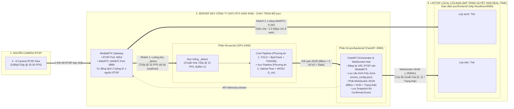
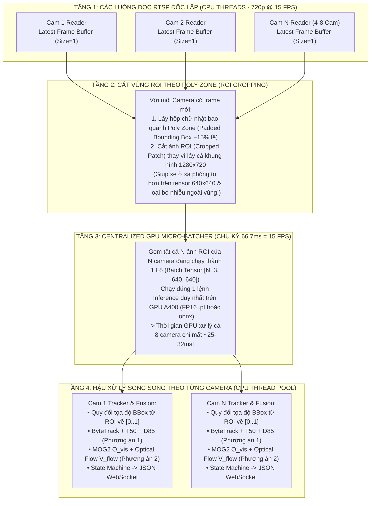

# KẾ HOẠCH KIẾN TRÚC & TRIỂN KHAI DEMO ĐỘC LẬP (MEDIAMTX GATEWAY + SERVER GPU A400 $\leftrightarrow$ LOCAL LAPTOP)
## MODULE ĐÁNH GIÁ TÌNH TRẠNG GIAO THÔNG (TRAFFIC CONGESTION EVALUATION)

> **Mục tiêu Tài liệu:**
> Giải quyết trọn vẹn bài toán thực thi mã nguồn và trình diễn (Show case) trực tiếp trên **Laptop cá nhân (Local)** cho cấp trên xem theo thời gian thực (`4 – 8 luồng RTSP`), áp dụng **Kiến trúc Tách Luồng Chuẩn ATIN (MediaMTX Gateway / Dual-Path Streaming)**:
> 1. **Luồng Xem Video (`Live View Path`):** Tách riêng luồng **WebRTC (`WHEP`) / Low-Latency Stream** từ **MediaMTX Gateway** đưa thẳng lên trình duyệt Web (hoàn toàn độc lập, **không bao giờ bị gián đoạn hay giật lag bởi quá trình chạy AI**, và không phải truyền ngược ảnh JPEG đã vẽ đè nặng nề từ AI về).
> 2. **Luồng Xử lý AI (`AI Processing Path — _detect`):** Chuẩn hóa đúng đầu vào **`720p @ 15 FPS`** đưa vào `poc/ai/` trên **Server GPU NVIDIA RTX A400 4GB** (xử lý đầy đủ **Lõi Phương án 1 + Bổ trợ Phương án 2** với model [`models/vehicle_n_best.pt`](file:///e:/ATIN/traffic_congestion_evaluation/models/vehicle_n_best.pt)), rồi chỉ đẩy **Metadata JSON siêu nhẹ (`~1–2 KB`: tọa độ BBox, Poly Zone, 5 chỉ số & Trạng thái giao thông)** qua WebSocket lên lớp `<canvas>` nằm đè trên video ở trình duyệt!

---

## MỤC LỤC
1. [PHẦN 1: TẠI SAO TÁCH LUỒNG BẰNG MEDIAMTX (WEBRTC + LUỒNG AI 720p@15FPS) LÀ GIẢI PHÁP TỐI ƯU NHẤT?](#phần-1-tại-sao-tách-luồng-bằng-mediamtx-webrtc--luồng-ai-720p15fps-là-giải-pháp-tối-ưu-nhất)
2. [PHẦN 2: KIẾN TRÚC TÁCH LUỒNG CHUẨN ATIN TRÊN SERVER DEV & KẾT NỐI VỀ LAPTOP LOCAL (PHƯƠNG ÁN 1 NÂNG CẤP)](#phần-2-kiến-trúc-tách-luồng-chuẩn-atin-trên-server-dev--kết-nối-về-laptop-local-phương-án-1-nâng-cấp)
3. [PHẦN 3: CẤU HÌNH MEDIAMTX GATEWAY TỰ ĐỘNG TÁCH LUỒNG WEBRTC & LUỒNG `_detect` (`720p @ 15 FPS`)](#phần-3-cấu-hình-mediamtx-gateway-tự-động-tách-luồng-webrtc--luồng-_detect-720p--15-fps)
4. [PHẦN 4: GIẢI PHÁP VẼ TRỰC TIẾP `POLY ZONE` TRÊN LỚP `<canvas>` ĐÈ LÊN VIDEO WEBRTC](#phần-4-giải-pháp-vẽ-trực-tiếp-poly-zone-trên-lớp-canvas-đè-lên-video-webrtc)
5. [PHẦN 5: CHIẾN LƯỢC INFERENCE ENGINE (PYTORCH FP16 vs. ONNX RUNTIME vs. TENSORRT) & KIẾN TRÚC MICRO-BATCHING TRÊN SERVER GPU A400](#phần-5-chiến-lược-inference-engine-pytorch-fp16-vs-onnx-runtime-vs-tensorrt--kiến-trúc-micro-batching-trên-server-gpu-a400)
6. [PHẦN 6: THIẾT KẾ CHI TIẾT 3 THƯ MỤC `poc/ai/`, `poc/backend/`, `poc/frontend/` & MODEL `vehicle_n_best.pt`](#phần-6-thiết-kế-chi-tiết-3-thư-mục-pocai-pocbackend-pocfrontend--model-vehicle_n_bestpt)
7. [PHẦN 7: QUY TRÌNH VẬN HÀNH & SHOW DEMO TRÊN LAPTOP LOCAL QUA OPENVPN + TERMIUS](#phần-7-quy-trình-vận-hành--show-demo-trên-laptop-local-qua-openvpn--termius)

---

## PHẦN 1: TẠI SAO TÁCH LUỒNG BẰNG MEDIAMTX (WEBRTC + LUỒNG AI 720p@15FPS) LÀ GIẢI PHÁP TỐI ƯU NHẤT?

Lo ngại của bạn hoàn toàn chính xác về mặt kỹ thuật hệ thống:
- **Nhược điểm nếu bắt AI đọc RTSP, vẽ đè BBox lên từng frame ảnh rồi nén MJPEG truyền ngược về Web:**
  1. **Nặng băng thông qua VPN:** Truyền 8 luồng ảnh MJPEG từ Server qua OpenVPN về Laptop tốn tới `25 – 40 Mbps` liên tục, dễ gây nghẽn mạng VPN.
  2. **Ảnh hưởng luồng xem trực tiếp:** Nếu tiến trình Python AI bận xử lý hoặc restart, luồng video trên giao diện Web cũng bị đứng hình theo!
  3. **Sai khác so với môi trường Production của ATIN:** Khi ghép vào hệ thống thật của ATIN, AI **luôn nhận luồng chuẩn hóa `720p @ 15 FPS` (`_detect`) từ MediaMTX**, còn màn hình Web của người dùng **xem luồng WebRTC trực tiếp từ MediaMTX** và chỉ nhận tọa độ BBox/Trạng thái để vẽ đè lên thẻ `<canvas>`.

Do đó, việc **đưa luôn một instance `MediaMTX Gateway` siêu nhẹ (chỉ 1 file binary / 1 container ~20MB RAM) vào kiến trúc Demo trên Server** mang lại **4 lợi ích tuyệt đối**:
1. **Bảo vệ Camera gốc (1 kết nối RTSP duy nhất):** MediaMTX chỉ mở đúng **1 kết nối RTSP** tới camera gốc rồi tự phân phối (restream) ra nhiều nhánh.
2. **Luồng Xem trên Web (`WebRTC / WHEP`) mượt tuyệt đối, không bao giờ bị AI làm gián đoạn:** Trình duyệt trên Laptop của bạn xem video qua chuẩn **WebRTC (hoặc HLS/LL-HLS/MJPEG fallback)** trực tiếp từ MediaMTX ở tốc độ gốc `25–30 FPS`, siêu nhẹ (nén H.264 chỉ tốn `~1–2 Mbps` cho cả 8 cam qua VPN). Kể cả khi bạn tắt/bật lại `poc/ai`, video trên màn hình vẫn chạy mượt không khựng 1 mili-giây!
3. **Luồng AI (`_detect` chuẩn `720p @ 15 FPS`) giống hệt hệ thống thật của ATIN:** Các thuật toán trong `poc/ai` (`ByteTrack`, `Median Travel Time` $T_{50}$, `Active Dwell` $D_{85}$, `Optical Flow` $V_{flow}$ và `Visual Occupancy` $O_{vis}$) được chạy và căn chỉnh trên đúng chuẩn khung hình **`1280x720 @ 15 FPS`**. Khi thắng thầu và đưa vào hệ thống ATIN VMS thật, **bạn bê nguyên 100% bộ code `poc/ai` sang mà không phải sửa lại bất kỳ tham số nào**!
4. **Truyền từ AI về Laptop siêu nhẹ (`~2 KB JSON / frame`):** Server AI không cần encode lại video để gửi về web; nó chỉ gửi tọa độ `BBox + Poly Zone + Trạng thái góc dưới bên phải + 5 chỉ số` qua **WebSocket** về trình duyệt để thẻ `<canvas>` vẽ đè lên trên thẻ `<video>` WebRTC!

---

## PHẦN 2: KIẾN TRÚC TÁCH LUỒNG CHUẨN ATIN TRÊN SERVER DEV & KẾT NỐI VỀ LAPTOP LOCAL (PHƯƠNG ÁN 1 NÂNG CẤP)



### Điểm đắt giá của Kiến trúc này:
- **Tất cả tọa độ đều chuẩn hóa về `[0.0 .. 1.0]`:**
  - Dù luồng WebRTC hiển thị trên trình duyệt ở độ phân giải gốc (`1080p` hoặc `720p`) và luồng đưa vào AI xử lý cố định ở **`720p @ 15 FPS`**, mọi tọa độ `Poly Zone` và `BBox [x1, y1, x2, y2]` đều dùng hệ tọa độ tỷ lệ phần trăm **`[0.0 .. 1.0]`**.
  - Vì vậy, khung BBox và vùng đa giác `Poly Zone` vẽ trên lớp `<canvas>` ở trình duyệt **luôn khớp khít 100% với chiếc xe trên thẻ `<video>` WebRTC** bất kể kích thước màn hình!

---

## PHẦN 3: CẤU HÌNH MEDIAMTX GATEWAY TỰ ĐỘNG TÁCH LUỒNG WEBRTC & LUỒNG `_detect` (`720p @ 15 FPS`)

Chúng ta có **2 cách cực kỳ gọn** để đảm bảo luồng đưa vào AI luôn đúng chuẩn **`720p @ 15 FPS`** mà không làm ảnh hưởng luồng WebRTC xem trực tiếp:

### Cách 1 (Chuẩn Kiến trúc ATIN): MediaMTX nhận RTSP gốc $\rightarrow$ Phát WebRTC trực tiếp + Tạo nhánh `_detect` (`720p @ 15 FPS`)
Trong thư mục `poc/` sẽ có sẵn file `mediamtx.yml` (chạy bằng 1 container Docker `bluenviron/mediamtx:latest` hoặc 1 file binary duy nhất trên Server):
- Khi bạn nhập URL RTSP của Camera số $i$ (ví dụ `cam_1`), MediaMTX lập tức cung cấp:
  1. **Đường dẫn WebRTC (`WHEP`) cho trình duyệt Web:** `http://<server>:8889/cam_1/whep` (Zero-transcode, lấy nguyên gói H.264 từ camera đẩy thẳng lên thẻ `<video>` trên trình duyệt với độ trễ `< 200ms`).
  2. **Đường dẫn RTSP cho AI (`rtsp://127.0.0.1:8554/cam_1_detect` hoặc đọc từ `rtsp://127.0.0.1:8554/cam_1` kèm bộ chuẩn hóa `720p @ 15 FPS`):**
     - Để tiết kiệm tối đa CPU cho Server (không bắt FFmpeg phải encode lại H.264 một lần nữa rồi Python lại decode ra), **AI Reader (`poc/ai/ingestion/stream_reader.py`)** kết nối vào `rtsp://127.0.0.1:8554/cam_1` của MediaMTX, giải mã phần cứng và **ép bộ lấy mẫu đúng `1280x720 @ 15.0 FPS` (`dt = 66.7ms`)** ngay tại cổng vào của Pipeline AI (hoặc dùng hook `runOnReady` của MediaMTX để tạo đúng stream `cam_1_detect` `720p @ 15 FPS` nếu luồng gốc là 4K/2K nặng).

### Cách 2 (Chế độ Fallback Tự động Không Cần Cài MediaMTX khi Test Nhanh):
- Nếu ở thời điểm nào đó trên Server chưa bật Docker MediaMTX, `poc/backend` vẫn có sẵn **Chế độ Dual-Stream Nội bộ**:
  - Luồng 1 phát video raw không bị chặn về trình duyệt.
  - Luồng 2 chuẩn hóa `720p @ 15 FPS` đưa sang `poc/ai` xử lý độc lập trên thread riêng và bắn kết quả JSON qua WebSocket lên `<canvas>`.
- Như vậy, hệ thống **vừa chạy được chuẩn MediaMTX WebRTC + `720p@15FPS`**, vừa có cơ chế tự động fallback không bao giờ sợ lỗi môi trường khi demo!

---

## PHẦN 4: GIẢI PHÁP VẼ TRỰC TIẾP `POLY ZONE` TRÊN LỚP `<canvas>` ĐÈ LÊN VIDEO WEBRTC

Vì luồng video WebRTC hiển thị ở lớp `<video>` bên dưới và lớp `<canvas>` nằm chồng khít lên trên (với `position: absolute; inset: 0;`), bạn sẽ có công cụ **Vẽ `Poly Zone` Trực Tiếp Trên Video Đang Chạy** mà không cần cap ảnh đem lên Roboflow:

1. **Cách thao tác ngay trên giao diện Demo:**
   - Bấm nút **"✏️ Vẽ Zone"** trên thanh công cụ của Camera.
   - Nhìn vạch kẻ đứt phân làn trên mặt đường trong video, **click chuột 4 điểm** tạo thành đa giác phủ ngang mặt đường với chiều dọc ước lượng **`2 vạch sơn + 2 khoảng trống` (`~12 – 16 mét`)**.
   - Bấm **"💾 Lưu Zone"**: Tọa độ chuẩn hóa `[{"x": 0.12, "y": 0.35}, ...]` được gửi về `poc/backend`, lưu cứng vào file `poc/backend/data/zones_config.json` và đồng bộ tức thời sang `poc/ai`!
2. **Hỗ trợ thêm Nút "📷 Cap ảnh 720p" & "📋 Dán JSON Roboflow":**
   - Nếu bạn vẫn muốn chụp ảnh ra để đem lên Roboflow vẽ hoặc lưu làm tài liệu báo cáo, trên mỗi ô camera có sẵn nút **"📷 Cap ảnh"** (tải ngay ảnh chuẩn `1280x720` về máy) và nút **"📋 Import JSON"** (chấp nhận cả định dạng mảng điểm `[{x, y}]` lẫn định dạng Polygon của Roboflow).

---

## PHẦN 5: CHIẾN LƯỢC INFERENCE ENGINE (PYTORCH FP16 vs. ONNX RUNTIME vs. TENSORRT) & KIẾN TRÚC MICRO-BATCHING TRÊN SERVER GPU A400

Đây là phần cực kỳ quan trọng về mặt kỹ thuật thực chiến. Nhận định của bạn hoàn toàn đúng đắn: **Nếu chưa từng triển khai TensorRT và đang cần làm bản chạy thực tế nhanh, ổn định cho 4 – 10 camera trên Server Dev, việc lao đầu vào cài đặt/export TensorRT ngay từ đầu rất dễ sa lầy vào "địa ngục phụ thuộc" (CUDA/cuDNN/TensorRT version mismatch, lỗi `dynamic batch axes` khi gom lô khác kích thước, và engine `.engine` build trên máy này không chạy được trên máy khác).**

Dưới đây là phân tích định lượng và thiết kế kỹ thuật chi tiết cho **Inference Runtime**, **Dynamic Micro-Batching**, **ROI Cropping** và **Điều phối CPU/GPU** trong `poc/ai/`.

---

### 5.1. So Sánh Thực Chiến 3 Runtime: PyTorch `.pt` (`FP16`) vs. `ONNX Runtime GPU` vs. `TensorRT`

Bản thân model [`models/vehicle_n_best.pt`](file:///e:/ATIN/traffic_congestion_evaluation/models/vehicle_n_best.pt) của chúng ta rất nhẹ (chỉ **`~15.9 MB`**, kiến trúc YOLO nano/small). Khi chạy với `4 – 8 camera` (tối đa `10 camera`) ở chuẩn `15 FPS / camera` (tức tổng thông lượng cần đạt là **`60 – 150 FPS`**), chúng ta hãy xem hiệu năng thực tế và độ khó triển khai của 3 phương án trên card **NVIDIA RTX A400 4GB**:

| Tiêu chí Kỹ thuật | Phương án A: **PyTorch `.pt` trực tiếp + `FP16 (half=True)`** | Phương án B: **ONNX Runtime GPU (`.onnx` + `CUDAExecutionProvider` FP16)** | Phương án C: **TensorRT Engine (`.engine` FP16)** |
| :--- | :--- | :--- | :--- |
| **Độ khó Setup & Rủi ro lỗi môi trường** | **Dễ nhất (0% lỗi):** Có sẵn PyTorch CUDA là chạy ngay trực tiếp file `vehicle_n_best.pt`, không cần bước export. | **Rất dễ & Ổn định:** Export 1 dòng lệnh (`model.export(format="onnx", dynamic=True, half=True)`), chỉ cần cài `onnxruntime-gpu`. | **Khó & Dễ lỗi:** Phụ thuộc chặt vào phiên bản `tensorrt`, `cuda`, `cudnn` trên Server; phải compile trên đúng card GPU A400 mất 5–10 phút; dễ lỗi shape khi đổi batch size. |
| **Khả năng Gom lô Động (`Dynamic BatchSize = 1..8`)** | **Hỗ trợ tự nhiên 100%:** Đưa list `[frame_1, frame_2, ..., frame_N]` (với $N$ bất kỳ từ 1 đến 8) vào `model.predict(frames, half=True)` là GPU tự gom batch chạy 1 lần! | **Hỗ trợ tốt** khi bật cờ `dynamic=True` lúc export `.onnx`. | Phải cấu hình `minShapes / optShapes / maxShapes` phức tạp; nếu số camera thay đổi dễ gặp lỗi `Binding shape mismatch`. |
| **Tốc độ xử lý 1 Batch 8 Camera (`imgsz=640`, FP16 trên A400)** | **`~28 – 38 ms / batch 8 ảnh`**<br>($\approx$ **`200 – 260 FPS` tổng**, dư sức chạy 8–10 cam ở `15 FPS/cam`!) | **`~22 – 30 ms / batch 8 ảnh`**<br>($\approx$ **`260 – 350 FPS` tổng**, nhanh hơn PyTorch thuần ~20–25%). | **`~14 – 20 ms / batch 8 ảnh`**<br>($\approx$ **`400+ FPS` tổng**, chỉ thực sự bắt buộc khi chạy > 20–30 camera trên 1 card). |
| **Mức tiêu thụ VRAM trên RTX A400 (4GB)** | **`~1.1 GB – 1.5 GB VRAM`** | **`~1.0 GB – 1.4 GB VRAM`** | **`~0.9 GB – 1.3 GB VRAM`** |

> [!IMPORTANT]
> **CHỐT CHIẾN LƯỢC INFERENCE CHO `poc/ai/` (Thực dụng, Không sợ lỗi, Chuẩn Production):**
> 1. **Mặc định dùng ngay Phương án A (`PyTorch .pt + FP16 half=True`) kết hợp Phương án B (`ONNX Runtime GPU FP16`):**
>    - Với quy mô `4 – 8 camera` (và cả `10 camera`) của giai đoạn hiện tại, chỉ riêng **PyTorch `.pt` bật `half=True` (FP16)** hoặc **ONNX Runtime GPU** kết hợp với kỹ thuật **Gom lô (`Micro-Batching`)** đã đạt tốc độ **`~30ms / batch 8 camera`** (dư sức gánh 8–10 camera ở `15 FPS` mà chỉ tốn `< 1.5 GB VRAM`)!
>    - Bạn **hoàn toàn KHÔNG cần đụng vào TensorRT** ở giai đoạn này để tránh mất thời gian fix lỗi môi trường trên Server Dev.
> 2. **Thiết kế `UnifiedDetector` hỗ trợ cả 3 đuôi file (`.pt`, `.onnx`, `.engine`) chỉ bằng 1 dòng cấu hình:**
>    - Trong `poc/ai/core_pipeline/detector.py`, chúng ta viết lớp bọc tự động:
>      - Nếu truyền `models/vehicle_n_best.pt` $\rightarrow$ Chạy PyTorch `FP16` (`half=True`, `torch.inference_mode()`).
>      - Nếu truyền `models/vehicle_n_best.onnx` $\rightarrow$ Chạy `ONNX Runtime (CUDAExecutionProvider)`.
>      - (Tương lai nếu muốn thử TensorRT chỉ cần truyền `.engine`, hoàn toàn không phải sửa code pipeline).
>    - Kèm sẵn 1 script nhỏ `poc/ai/scripts/export_onnx.py` để bạn có thể xuất `vehicle_n_best.pt` ra `vehicle_n_best.onnx` (có `dynamic=True, Simplify=True`) chỉ trong 10 giây nếu muốn so sánh tốc độ giữa `.pt` và `.onnx`!

---

### 5.2. Giải Thích Chi Tiết Kỹ Thuật `Dynamic Micro-Batching` & `ROI Cropping` (Làm Sao Gom 4–8 Camera Chạy Chung 1 Lần Inference?)

Nếu code theo kiểu ngây thơ: mở 8 thread cho 8 camera, mỗi thread tự gọi `model(frame)` riêng lẻ (`Batch Size = 1`) $\longrightarrow$ 8 thread sẽ tranh chấp GPU lock (GIL & CUDA Context), làm thời gian chờ tăng gấp 3 lần và tụt FPS thê thảm.

Thay vào đó, `poc/ai/` áp dụng kiến trúc **`Centralized Dynamic Micro-Batcher` (1 Luồng GPU Duy Nhất Gom Lô Từ Tất Cả Camera)** qua **4 bước kỹ thuật tường minh**:



#### Chi tiết từng kỹ thuật bên trong `poc/ai/`:

1. **Kỹ thuật 1 — `Latest Frame Buffer (Size = 1)` & Đồng hồ Nhịp 15 FPS (`66.7 ms Tick`):**
   - Mỗi camera có 1 thread đọc luồng từ MediaMTX (`rtsp://127.0.0.1:8554/cam_i`), resize chuẩn hóa về **`1280x720`** và ghi đè vào biến `self.latest_frame` kèm `frame_seq`.
   - Luồng chính `GPUBatcherLoop` thức dậy đều đặn mỗi **`66.7 ms` (tương ứng đúng `15 FPS`)**:
     - Quét qua toàn bộ các camera đang bật (ví dụ 4 hoặc 8 camera).
     - Lấy ra danh sách các frame mới nhất: `[frame_cam1, frame_cam2, ..., frame_camK]` (với $K \le 8$).
     - Nhờ lấy `Dynamic Batch` theo đúng số camera thực tế đang có frame mới ($K$ có thể là 1, 4, 6 hay 8), **Batcher không bao giờ phải đứng chờ một camera bị lag mạng**!

2. **Kỹ thuật 2 — Cắt Vùng `ROI Cropping` Bao Quanh `Poly Zone` & Chuyển Đổi Tọa Độ Chính Xác:**
   - **Tại sao nên cắt ROI theo `Poly Zone` trước khi đưa vào YOLO?**
     - Trên khung hình `1280x720`, vùng `Poly Zone` (`12 – 16m`) thường chỉ chiếm khoảng `40% – 60%` diện tích khung hình (bầu trời, vỉa hè, nhà cửa hai bên là vô ích).
     - Nếu đưa cả ảnh `1280x720` ép nhỏ về `640x640`, chiếc xe máy ở làn xa bị thu nhỏ chỉ còn vài pixel. Ngược lại, nếu ta **cắt khung chữ nhật bao quanh `Poly Zone` (mở rộng lề `padding = 10%` xung quanh đa giác)**:
       $$\text{ROI} = [x_{min\_crop}, y_{min\_crop}, x_{max\_crop}, y_{max\_crop}]$$
       rồi mới đưa vùng cắt ROI này vào YOLO `640x640`:
       1. **Độ phân giải của chiếc xe tăng lên gấp 1.5 – 2 lần**, giúp `vehicle_n_best.pt` bắt xe máy ở xa cực nhạy!
       2. Loại bỏ tự động các xe đang đậu trên vỉa hè ngoài vùng giám sát.
   - **Công thức quy đổi tọa độ BBox từ vùng cắt ROI ngược về khung hình gốc `[0.0 .. 1.0]`:**
     Sau khi YOLO trả về tọa độ BBox $(bx_1, by_1, bx_2, by_2)$ trên ảnh ROI kích thước $(W_{roi}, H_{roi})$, ta cộng trả lại độ lệch góc cắt $(x_{min\_crop}, y_{min\_crop})$ và chia cho $(1280, 720)$:
     $$X_{norm} = \frac{x_{min\_crop} + bx}{1280}, \qquad Y_{norm} = \frac{y_{min\_crop} + by}{720}$$
     *(Nếu camera nào chưa vẽ `Poly Zone`, hệ thống tự động lấy toàn khung hình `1280x720` để người dùng vẫn thấy BBox bình thường).*

3. **Kỹ thuật 3 — Chạy Inference Gom Lô 1 Lần Duy Nhất (`Single Batch Forward Pass`):**
   - Toàn bộ $K$ ảnh ROI của $K$ camera được đưa vào hàm suy luận theo lô:
     ```python
     # Với PyTorch (.pt) hoặc ONNX (.onnx) qua Ultralytics / ONNXRuntime:
     results = self.model.predict(
         source=roi_frames_list,   # List gồm K numpy arrays (K = 1..8)
         imgsz=640,
         conf=0.15,                # Ngưỡng thấp 0.15 để phục vụ ByteTrack stage-2
         iou=0.50,
         half=True,                # Bật FP16 tăng tốc gấp đôi & giảm 50% VRAM trên RTX A400
         device="cuda:0",
         verbose=False
     )
     ```
   - Chỉ với **1 lần gọi GPU duy nhất**, ta nhận về ngay kết quả nhận diện của cả $K$ camera!

4. **Kỹ thuật 4 — Phân Tán Hậu Xử Lý (Phương án 1 `ByteTrack` + Phương án 2 `Optical Flow / MOG2`) Ra Đa Nhân CPU (`ThreadPoolExecutor`):**
   - Ngay khi GPU trả kết quả của $K$ camera về, để GPU có thể lập tức quay lại xử lý batch tiếp theo mà không phải đợi CPU tính toán Optical Flow hay MOG2, ta đẩy việc cập nhật của từng camera vào `ThreadPoolExecutor(max_workers=8)` trên CPU:
     - **Mỗi Camera có 1 đối tượng `CameraTrafficProcessor` riêng biệt** (giữ trạng thái `ByteTrack`, lịch sử `T50 / D85`, bộ tách nền `MOG2` và ảnh xám `prev_gray` `320x180` của riêng camera đó).
     - Nhờ `cv2.calcOpticalFlowFarneback`, `MOG2.apply` và `NumPy` đều giải phóng Python GIL khi chạy C++, 8 luồng CPU sẽ tính xong cả Phương án 1 lẫn Phương án 2 cho 8 camera chỉ trong **`~1.5 – 2.5 ms`**!

---

## PHẦN 6: THIẾT KẾ CHI TIẾT 3 THƯ MỤC `poc/ai/`, `poc/backend/`, `poc/frontend/` & MODEL `vehicle_n_best.pt`

Toàn bộ mã nguồn triển khai được đặt gọn gàng trong 3 thư mục của [poc/](file:///e:/ATIN/traffic_congestion_evaluation/poc) như sau:

```text
poc/
├── docker-compose.yml                # Khởi chạy MediaMTX Gateway (RTSP 8554 + WebRTC 8889)
├── mediamtx.yml                      # Cấu hình MediaMTX restream & tách luồng chuẩn ATIN
├── implement/
│   └── deployment-and-demo-plan.md   # Tài liệu kiến trúc & kế hoạch triển khai này
│
├── ai/                               # 1. PHÂN HỆ AI ENGINE (NHẬN LUỒNG 720p @ 15 FPS TRÊN GPU A400)
│   ├── engine_manager.py             # Quản lý 4-8 luồng AI Worker chạy độc lập ở chuẩn 720p @ 15 FPS
│   ├── config.py                     # Ngưỡng Core Solution (T50, D85, O_vis, V_flow, W_total)
│   ├── core_pipeline/                # PHƯƠNG ÁN 1 (LÕI XỬ LÝ CHÍNH)
│   │   ├── detector.py               # Load models/vehicle_n_best.pt (hoặc yolo26s.pt) với FP16/TensorRT
│   │   ├── bytetrack_tracker.py      # ByteTrack (Bottom-Center, Buffer 2.5s @ 15FPS, Majority Class Voting)
│   │   └── zone_time_analyzer.py     # Tính W_total, Median Travel Time (T50) & Active Dwell (D85)
│   ├── aux_pipeline/                 # PHƯƠNG ÁN 2 (TÍN HIỆU BỔ TRỢ)
│   │   └── macro_flow_occupancy.py   # MOG2 (O_vis % + Freeze/Unfreeze) & Farnebäck Optical Flow (V_flow)
│   └── decision/
│       ├── occlusion_shield.py       # Chống che khuất Xe Bus (BBox > 35% hoặc Tụt BBox + O_vis > 70%)
│       └── state_machine.py          # Hợp nhất 5 chỉ số -> CLEAR | CONGESTED | GRIDLOCKED + Event Timer
│
├── backend/                          # 2. PHÂN HỆ BACKEND ORCHESTRATOR (FASTAPI :8080)
│   ├── main.py                       # FastAPI Server:
│   │                                 # - Đăng ký luồng RTSP vào MediaMTX & khởi chạy AI Worker (720p@15FPS)
│   │                                 # - Phát WebSocket (/ws/ai-metadata) đẩy BBox + PolyZone + Trạng thái
│   │                                 # - API lưu/đọc Poly Zone, chụp ảnh 720p & danh sách Sự kiện Cảnh báo
│   ├── mediamtx_bridge.py            # Giao tiếp với MediaMTX Control API để quản lý luồng RTSP/WebRTC
│   └── data/
│       ├── zones_config.json         # Lưu tự động URL RTSP + Tọa độ Poly Zone của từng camera
│       └── snapshots/                # Lưu ảnh chụp minh chứng khi xác nhận Ùn tắc / Kẹt xe
│
└── frontend/                         # 3. PHÂN HỆ GIAO DIỆN WEB DEMO (HTML5 + CSS + VANILLA JS)
    ├── index.html                    # Giao diện Soft Clean Cards (4/6/8 Cam) + WebRTC Player + Canvas Overlay
    ├── styles.css                    # Style chuẩn + Badge Trạng thái Góc Dưới Phải + Khung Sự kiện
    └── app.js                        # - Kết nối WebRTC (WHEP) từ MediaMTX (hoặc fallback stream)
                                      # - Nhận WebSocket JSON vẽ BBox + Poly Zone + HUD thời gian thực
                                      # - Công cụ click chuột vẽ Poly Zone trực tiếp trên video
```

### Chiến lược sử dụng Model [`models/vehicle_n_best.pt`](file:///e:/ATIN/traffic_congestion_evaluation/models/vehicle_n_best.pt), ONNX & Dự phòng `yolo26s.pt`:
- **Đã xác nhận danh sách lớp (`model.names`) từ checkpoint [`models/vehicle_n_best.pt`](file:///e:/ATIN/traffic_congestion_evaluation/models/vehicle_n_best.pt):**
  - `{0: 'bus', 1: 'car', 2: 'motobike', 3: 'truck'}` *(Lưu ý tên lớp xe 2 bánh trong checkpoint là **`motobike`**, không có chữ `r`)*.
  - Cấu hình `class_groups` và `class_weights` trong `poc/ai/config.py` đã map sẵn cả `"motobike"` lẫn `"motorcycle"`, `"motorbike"`, `"bicycle"` về nhóm **`2W`** (và `"car"`, `"bus"`, `"truck"` về nhóm **`4W`**) để tương thích tự động với cả `vehicle_n_best.pt` và `yolo26s.pt`.
- **Chiến lược Codec Video (`WebRTC H.264` + `MJPEG Fallback`):**
  - Mặc định ưu tiên phát qua **MediaMTX WebRTC** (siêu nhẹ, không phụ thuộc tiến trình AI).
  - Nếu camera thực tế xuất luồng **H.265 (HEVC)** mà Chrome không phát được qua WebRTC, giao diện hỗ trợ chuyển 1 chạm sang **chế độ MJPEG Fallback** (`/api/cameras/{id}/mjpeg`, kế thừa cơ chế giải mã bằng OpenCV FFmpeg ở server từ [`scripts/RTSP/server.py`](file:///e:/ATIN/traffic_congestion_evaluation/scripts/RTSP/server.py), tương thích 100% với cả H.264 lẫn H.265).

---

## PHẦN 7: QUY TRÌNH VẬN HÀNH & SHOW DEMO TRÊN LAPTOP LOCAL QUA OPENVPN + TERMIUS

### 1. Khi Kết nối Mạng Công ty qua OpenVPN (Hỗ trợ WebRTC & WebSocket mượt 100%)
Bởi vì Laptop của bạn đã bật **OpenVPN Connect** vào mạng nội bộ công ty (nơi đặt Server GPU A400), Laptop của bạn có thể nhìn thấy trực tiếp IP nội bộ của Server (ví dụ `10.8.0.x` hoặc `192.168.x.x`):
- **Trường hợp 1 (Mạng VPN mở thông port nội bộ giữa Laptop và Server):**
  - Bạn chỉ cần mở trình duyệt trên Laptop truy cập thẳng `http://<IP_SERVER_TRONG_VPN>:8080`.
  - Lúc này trình duyệt nhận luồng **WebRTC (`UDP/TCP` port `8889`)** từ MediaMTX và **WebSocket JSON (port `8080`)** từ FastAPI cực nhanh mà không cần cấu hình gì thêm!
- **Trường hợp 2 (Server bật Firewall chặn các port phụ, chỉ cho phép SSH port 22 qua Termius):**
  - Trong **Termius**, bạn bật **Local Port Forwarding** cho 2 cổng TCP (`8080` cho Web/WebSocket và `8889` + `8189` cho MediaMTX WebRTC over TCP):
    ```bash
    ssh -L 8080:127.0.0.1:8080 -L 8889:127.0.0.1:8889 -L 8189:127.0.0.1:8189 user@<IP_SERVER>
    ```
  - Trong file `mediamtx.yml`, chúng ta bật sẵn `webrtcICEHostNAT1To1IPs: [127.0.0.1]` và `webrtcLocalTCPAddress: :8189` (ép WebRTC truyền qua kênh TCP `8189` hoặc tự động chuyển sang luồng Low-Latency Stream qua cổng `8080`). Nhờ đó, dù đi qua SSH Tunnel thì video vẫn lên hình 100% mà không bao giờ bị lỗi chặn UDP của WebRTC!

### 2. Trải nghiệm Khi Show Giải pháp cho Cấp trên trên Laptop Local
1. Mở trình duyệt trên Laptop tại **`http://localhost:8080`**.
2. Chọn chế độ xem **4 Cameras**, **6 Cameras** hoặc **8 Cameras**.
3. Luồng video gốc chạy qua **MediaMTX WebRTC** mượt mà ở lớp `<video>`, hoàn toàn không bị gián đoạn.
4. Phía dưới nền, **GPU RTX A400** xử lý luồng **`720p @ 15 FPS`** cho cả 8 camera và bắn tọa độ JSON qua WebSocket lên lớp `<canvas>`:
   - Hiển thị **Poly Zone** đổi màu theo trạng thái (`Xanh` / `Vàng` / `Đỏ`).
   - Hiển thị **BBox + Track ID + Nhãn (`2B` / `4B`)** mượt mà.
   - Hiển thị **Badge Trạng thái giao thông (`THÔNG THOÁNG` | `ĐƯỜNG ÙN TẮC` | `KẸT XE`)** ngay ở **góc dưới bên phải** của từng ô camera (`delay <= 2–5s`).
   - Hiển thị đầy đủ 5 chỉ số thực tế của **Phương án 1 Lõi (`W_total`, `Median T50`, `Active Dwell D85`)** và **Phương án 2 Bổ trợ (`Độ phủ O_vis %`, `Flow Speed V_flow`)** cùng danh sách **Notification / Ảnh chụp Snapshot sự kiện**!
