# BÁO CÁO KỸ THUẬT: GIẢI PHÁP ĐÁNH GIÁ MỨC ĐỘ ÙN TẮC GIAO THÔNG REALTIME

**Dự án:** ATIN – Đánh giá ùn tắc giao thông (`traffic_congestion_evaluation`)  
**Phạm vi áp dụng:** Lõi AI đánh giá ùn tắc và tích hợp hiển thị lên hệ thống AIOC Staging  
**Ngày cập nhật:** 18/11/2026

---

## 1. Tóm tắt bài toán và Mục tiêu thiết kế

Hệ thống có nhiệm vụ phân loại tình trạng giao thông tại một vùng giám sát (_Poly Zone_) thành **3 trạng thái**: `CLEAR` (_Thông thoáng_), `CONGESTED` (_Ùn tắc_) và `GRIDLOCKED` (_Kẹt cứng_). Giải pháp được thiết kế để giải quyết 4 yêu cầu thực tế:

1. **Phân biệt "đông xe nhưng vẫn di chuyển" với "ùn tắc thật":** Khi đường đông nhưng xe vẫn thoát qua ngã tư bình thường, hệ thống không được báo động giả.
2. **Ổn định khi mất nhận diện phương tiện (BBox):** Khi xe chen đặc hoặc góc camera bị khuất khiến bộ theo dõi bị đứt ID, hệ thống vẫn đánh giá được tình trạng kẹt dựa trên mật độ chuyển động và độ phủ mặt đường.
3. **Chống nhiễu ban đêm (_lý thuyết_) và xe lớn che khuất:** Không nhận nhầm ánh đèn pha loang trên đường vắng thành kẹt xe; giữ ổn định trạng thái khi xe buýt hoặc xe tải lớn tạm thời che kín vùng quan sát.
4. **Độ trễ thấp trên giao diện giám sát:** BBox bám sát chuyển động xe ở ~25 FPS, không bị chặn bởi các phép tính phân tích nền.

---

## 2. Kiến trúc tổng thể hệ thống

Hệ thống vận hành theo mô hình **1 tiến trình đa luồng bất đồng bộ**, tách riêng luồng vẽ BBox tốc độ cao và luồng tính toán chỉ số ùn tắc:

| Giai đoạn                | Thành phần                                        | Nhiệm vụ chính                                                                                                                                                                                                                                 | Tần suất / Độ trễ          |
| :----------------------- | :------------------------------------------------ | :--------------------------------------------------------------------------------------------------------------------------------------------------------------------------------------------------------------------------------------------- | :------------------------- |
| **1. Đọc luồng RTSP**    | `StreamReader`                                    | Giải mã RTSP qua FFmpeg CUDA (`cuda_hwaccel` / `h264_cuvid`, dự phòng `OpenCV`), chuẩn hóa khung hình về `1280×720`, chỉ giữ frame mới nhất.                                                                                                   | ~25 FPS                    |
| **2. Luồng nhanh (GPU)** | `Detector` + `CameraTracker`                      | Chạy YOLO (`vehicle_n_best.pt`, `FP16`, `imgsz=640`, `conf=0.15`) trên vùng cắt `ROI` mở rộng, gán ID bằng `ByteTrack` (`activation_conf=0.25`) và khớp IoU ngược về BBox YOLO gốc để khử trễ pha Kalman. Gửi BBox + HUD lên Web ngay lập tức. | ~15–20 ms/frame            |
| **3. Luồng nền (CPU)**   | `ZoneTimeAnalyzer` + `FlowOccupancy`              | Chạy song song ở luồng nền qua bộ nhớ ghi đè không chặn: tính số lượng xe, thời gian thoát vùng (`T50`), thời gian hiện diện (`D85`), độ phủ (`O_vis`) và tốc độ dòng xe (`V_flow`).                                                           | Song song, không chặn BBox |
| **4. Ra quyết định**     | `OcclusionShield` + `classify()` + `StateMachine` | Kiểm tra che khuất, phân loại trạng thái tức thời kèm độ tự tin, làm mượt hiển thị (`5s`) và quản lý chu kỳ gửi sự kiện (`3p → 5p → 15p`).                                                                                                     | Cập nhật liên tục          |

### Tách biệt vùng tính toán (`zone_px` và `flow_zone_px`)

- **`zone_px` (Poly Zone gốc người dùng vẽ, dài ~18–22m dọc trục đường):** Dùng để đếm xe, tính `T50`, `D85` và kiểm tra che khuất.
- **`flow_zone_px` (tự động kéo dài thêm +20% ở cả hai đầu trục đường, giữ nguyên bề ngang):** Dùng để đo độ phủ `O_vis`, tốc độ dòng xe `V_flow` và làm vùng cắt ảnh cho YOLO nhằm quan sát đủ ngữ cảnh xe vào/ra.

---

## 3. Phương pháp tính toán các thông số hiển thị trên giao diện

Trên giao diện giám sát trực tiếp (HUD), hệ thống hiển thị các thông số sau: **Độ phủ (`O_vis`)**, **Dòng xe (`V_flow`)**, **Số lượng xe trong vùng (`xe máy` / `ô tô`)**, **Thoát vùng (`T50`)** và **Dừng/chậm (`D85`)**.

### 3.1. Nhóm thông số dựa trên theo dõi phương tiện (`ZoneTimeAnalyzer`)

- **Số lượng xe và Trọng số mật độ (`W_total`):** Đếm số `xe máy` (`2B`, trọng số `1.0`) và `ô tô` (`4B`: ô tô trọng số `3.0`; xe buýt/xe tải trọng số `6.0`) có chân BBox nằm trong `zone_px`, làm mượt theo thời gian ($\tau = 3.0\text{s}$). `W_total` dùng để xác nhận có phương tiện thực tế (`W_total >= 3.0`) và cộng điểm tự tin.
- **Thời gian thoát vùng – `T50` (hiển thị tách riêng cho `Ô tô` và `Xe máy`, đơn vị giây):** Là trung vị thời gian hoàn thành hành trình của các xe đã đi qua `zone_px` trong cửa sổ trượt **30 giây** gần nhất.
  - **Điều kiện kích hoạt:** Chỉ có giá trị khi có **ít nhất 2 xe** cùng nhóm (`Ô tô` hoặc `Xe máy`) di chuyển được quãng đường **$\ge 45\%$** chiều dài trục `zone_px` rồi đi ra khỏi vùng (hoặc mất dấu $\ge 1.0\text{s}$). Nếu chưa đủ 2 xe, giao diện hiển thị `–`.
- **Thời gian hiện diện trong vùng – `D85` (hiển thị tách riêng cho `Ô tô` và `Xe máy`, đơn vị giây):** Là bách phân vị thứ 85 của khoảng thời gian mà các xe **đang còn nằm bên trong `zone_px`** đã trải qua (tính từ lúc xe đi vào vùng đến thời điểm hiện tại).
  - **Điều kiện kích hoạt:** Chỉ có giá trị khi có **ít nhất 2 xe** cùng nhóm đang nằm trong `zone_px` từ **2.0 giây trở lên**. Nếu chưa đủ 2 xe, giao diện hiển thị `–`.

> **Lưu ý:** `T50` và `D85` được tính liên tục ở mọi khung hình ngay khi đủ số mẫu ($\ge 2$ xe), không phụ thuộc vào việc độ phủ `O_vis` cao hay thấp.

### 3.2. Nhóm thông số vĩ mô mặt đường (`FlowOccupancy`)

- **Độ phủ (`O_vis`, đơn vị `%`):** Hợp nhất mặt nạ chuyển động `MOG2` (đã loại bỏ bóng râm) và mặt nạ BBox YOLO trên lưới `320×180`, áp dụng **trọng số phối cảnh tuyến tính theo trục dọc** (vùng xa camera có trọng số cao hơn vùng gần camera) để tránh khoảng trống sát ống kính làm tụt sai chỉ số. Khi xe đứng yên lâu (`D85 > 5.0s` hoặc `W_total >= 3.0`), hệ thống tự động đóng băng tốc độ học nền của `MOG2` để xe đang kẹt không bị hòa tan vào nền đường.
- **Tốc độ dòng xe (`V_flow`, đơn vị `px/s` trên ảnh `320×180`):** Tính bằng _Optical Flow Farneback_ trên các pixel thuộc mặt nạ chiếm dụng `O_vis`, lấy trung vị độ lớn vector dịch chuyển có lọc nhiễu nền (`< 0.8 px/frame`), chia cho `dt` (_khoảng thời gian chênh lệch giữa hai khung hình liên tiếp được xử lý_) để quy đổi về `px/s` rồi làm mượt EMA.

---

## 4. Luật quyết định trạng thái và Vòng đời sự kiện

Tại mỗi chu kỳ xử lý nền, quyết định trạng thái đi qua **3 tầng tuần tự**: kiểm tra che khuất $\rightarrow$ phân loại trạng thái tức thời $\rightarrow$ làm mượt và phát sự kiện.

### Tầng 1: Xử lý khi bị che khuất (`OcclusionShield`)

Hệ thống tạm khóa trạng thái hiện tại (trạng thái `HOLD`, hiển thị kèm nhãn _che khuất_ và không phát sự kiện mới) khi xảy ra **1 trong 2** tình huống trên `zone_px`:

1. Tổng diện tích BBox `bus` / `truck` che phủ **$> 45\%$** diện tích vùng giám sát.
2. Số lượng BBox trong vùng giảm đột ngột **$\ge 65\%$** so với trung bình 3 giây trước đó, trong khi độ phủ `O_vis` vẫn ở mức cao (**$\ge 72\%$**).

Nếu tình trạng che khuất kéo dài liên tục quá **40.0 giây**, hệ thống chuyển sang trạng thái `UNKNOWN` (_Mất tín hiệu_) để tránh giữ trạng thái cũ quá lâu.

### Tầng 2: Quy tắc phân loại 3 trạng thái (`classify()`)

Khi không bị che khuất, bộ phân loại dựa trên 4 nhóm thông số hiển thị trên HUD (`Độ phủ O_vis`, `Tốc độ dòng xe V_flow`, `T50 / D85` và `Số lượng xe`) cùng **Bảng ngưỡng thời gian** dưới đây:

| Mức ngưỡng thời gian |     Ô tô / Buýt / Tải (`4B`)     |          Xe máy (`2B`)           |
| :------------------- | :------------------------------: | :------------------------------: |
| **Ngưỡng Chậm**      |  `T50 > 5.5s` hoặc `D85 > 6.5s`  |  `T50 > 4.5s` hoặc `D85 > 5.0s`  |
| **Ngưỡng Kẹt**       | `T50 > 16.0s` hoặc `D85 > 20.0s` | `T50 > 13.5s` hoặc `D85 > 17.0s` |

Dưới đây là **điều kiện đầy đủ** để chuyển sang từng trạng thái (được kiểm tra theo thứ tự ưu tiên từ `THÔNG THOÁNG` $\rightarrow$ `KẸT XE` $\rightarrow$ `ÙN TẮC`):

#### A. Trạng thái `THÔNG THOÁNG (CLEAR)`

Hệ thống kết luận `CLEAR` khi thỏa mãn **bất kỳ** trường hợp nào sau đây:

1. **Đường vắng:** Độ phủ `O_vis < 40%`.
2. **Không có phương tiện thực tế (lọc nhiễu ánh đèn ban đêm / trời mưa):** Tổng trọng số xe trong vùng `W_total < 3.0` (chưa đủ tương đương 1 ô tô hoặc 3 xe máy) **VÀ** cả `T50`, `D85` đều chưa có giá trị (`–`). Trường hợp này vẫn giữ `CLEAR` dù ánh đèn loang làm `O_vis` lên tới 70%–90%.
3. **Dòng xe thoát nhanh:** Tốc độ dòng xe `V_flow > 18.0 px/s` (luôn kết luận `CLEAR` bất kể độ phủ đang ở mức 40%–90% hay thời gian đo được là bao nhiêu).
4. **Đường đông nhưng vẫn lưu thông bình thường:** Độ phủ từ `40%` đến dưới `70%` **VÀ** chưa đủ điều kiện ùn cục bộ (tức không có chỉ số `T50`/`D85` nào vượt Ngưỡng Kẹt, hoặc có vượt nhưng `V_flow > 15.0 px/s`).
5. **Độ phủ cao (`≥ 70%`) nhưng xe vẫn thoát đều:**
   - Khi có `T50`/`D85`: `V_flow ≤ 18.0 px/s` nhưng thời gian `T50` của cả ô tô lẫn xe máy đều không vượt Ngưỡng Chậm (`≤ 5.5s` và `≤ 4.5s`), và nếu nhóm nào chưa có `T50` thì `D85` của nhóm đó cũng không vượt Ngưỡng Chậm (hoặc `V_flow > 15.0 px/s`).
   - Khi chưa có cả `T50` lẫn `D85`: `70% ≤ O_vis < 85%` với `V_flow > 14.0 px/s`, hoặc `O_vis ≥ 85%` với `V_flow > 14.0 px/s`.

#### B. Trạng thái `KẸT XE / KẸT CỨNG (GRIDLOCKED)`

Hệ thống kết luận `GRIDLOCKED` khi có phương tiện thực tế trong vùng (hoặc đã có `T50`/`D85`), **Độ phủ `O_vis ≥ 85%`** **VÀ** thỏa mãn **một trong hai** điều kiện sau:

1. **Khi có dữ liệu `T50` hoặc `D85`:** Tốc độ dòng xe `V_flow ≤ 15.0 px/s` **VÀ** có ít nhất một chỉ số vượt **Ngưỡng Kẹt** (`T50` ô tô `> 16.0s`, `D85` ô tô `> 20.0s`, `T50` xe máy `> 13.5s`, hoặc `D85` xe máy `> 17.0s`).
2. **Khi mất toàn bộ `T50` và `D85` (đều hiển thị `–` do xe chen quá đặc):** Tốc độ dòng xe `V_flow ≤ 6.0 px/s`.

#### C. Trạng thái `ÙN TẮC (CONGESTED)`

Hệ thống kết luận `CONGESTED` khi có phương tiện thực tế (hoặc đã có `T50`/`D85`), không rơi vào các trường hợp `CLEAR` hay `GRIDLOCKED` ở trên, và thỏa mãn **một trong ba** điều kiện sau:

1. **Độ phủ `≥ 70%` và có dữ liệu `T50` hoặc `D85`:** Tốc độ dòng xe `V_flow ≤ 18.0 px/s` **VÀ** thỏa ít nhất một điều kiện chậm theo thứ tự ưu tiên `T50` trước, `D85` sau:
   - **Ưu tiên `T50`:** `T50` ô tô `> 5.5s` hoặc `T50` xe máy `> 4.5s`.
   - **Dự phòng `D85`:** Chỉ dùng cho nhóm xe chưa có `T50` (hiển thị `–` trên HUD), yêu cầu `D85` ô tô `> 6.5s` hoặc `D85` xe máy `> 5.0s` **VÀ** tốc độ dòng xe `V_flow ≤ 15.0 px/s`.
     _(Trường hợp `O_vis ≥ 85%` nhưng thời gian mới vượt Ngưỡng Chậm mà chưa đạt Ngưỡng Kẹt cũng trả về `CONGESTED`.)_
2. **Độ phủ `≥ 70%` nhưng chưa có cả `T50` lẫn `D85` (đều hiển thị `–`):**
   - Nếu `70% ≤ O_vis < 85%`: Tốc độ dòng xe `V_flow ≤ 14.0 px/s`.
   - Nếu `O_vis ≥ 85%`: Tốc độ dòng xe trong khoảng `6.0 px/s < V_flow ≤ 14.0 px/s`.
3. **Ùn cục bộ ở độ phủ trung bình (`40% ≤ O_vis < 70%`):** Tốc độ dòng xe `V_flow ≤ 15.0 px/s` **VÀ** có ít nhất một chỉ số `T50` hoặc `D85` vượt **Ngưỡng Kẹt** (`T50` ô tô `> 16.0s`, `D85` ô tô `> 20.0s`, `T50` xe máy `> 13.5s`, hoặc `D85` xe máy `> 17.0s`).

### Tầng 3: Làm mượt hiển thị, Xác nhận sự kiện và Vòng đời thông báo (`StateMachine`)

Hệ thống tách biệt **2 lớp trạng thái** nhằm vừa đảm bảo giao diện bám sát thực tế, vừa tránh spam cảnh báo về Server:

1. **Lớp hiển thị trực tiếp (`display_state` – cập nhật lên HUD):**
   - **Làm mượt đa số (`5.0s`):** Lấy trạng thái chiếm đa số trong cửa sổ trượt **5.0 giây** gần nhất (nếu hòa phiếu thì ưu tiên mức nặng hơn: `GRIDLOCKED > CONGESTED > CLEAR`).
   - **Chống nhấp nháy khi hạ mức (`10.0s`):** Khi `display_state` đang ở `CONGESTED` hoặc `GRIDLOCKED`, hệ thống chỉ cho phép hạ về `CLEAR` khi trạng thái làm mượt giữ `CLEAR` liên tục tối thiểu **10.0 giây**.
   - **Khi bị che khuất / mất luồng:** Nếu `OcclusionShield` kích hoạt `HOLD`, `display_state` giữ nguyên trạng thái trước đó; nếu che khuất kéo dài **> 40.0 giây** (`UNKNOWN_HOLD`) hoặc mất luồng RTSP **> 5.0 giây**, `display_state` chuyển sang `UNKNOWN`.

2. **Lớp sự kiện xác nhận (`confirmed_state` – bắn thông báo & ghi nhận lên Server):**
   - **Thời gian ghi nhận đến khi xác nhận sự kiện (`180 giây / 3 phút`):** Khi `display_state` chuyển sang một trạng thái mới khác với `confirmed_state`, hệ thống bắt đầu đếm thời gian duy trì ứng viên (`_candidate_state`). Trong quá trình tích lũy, hệ thống **cho phép nhiễu gián đoạn ngắn tối đa `5.0 giây`** (nếu quay lại trạng thái cũ $\le 5.0\text{s}$ rồi trở lại trạng thái mới thì không bị đặt lại bộ đếm; nếu quá `5.0s` mới hủy ứng viên).
   - **Chu kỳ bắn sự kiện & hành động ghi nhận lên Server** (chế độ vận hành chuẩn; khi bật duyệt gửi sự kiện `EVENT_PUBLISH_MODE != NONE/LOG_ONLY`):
     - **Mốc 3 phút (`CONFIRMED_3M`):** Khi `CONGESTED` hoặc `GRIDLOCKED` duy trì đủ **180 giây (3 phút)**, `confirmed_state` chính thức chuyển sang trạng thái mới và **bắn ngay sự kiện xác nhận đầu tiên** kèm ảnh bằng chứng lên Server.
     - **Mốc 5 phút (`FOLLOWUP_5M`):** Nếu tình trạng ùn tắc tiếp tục giữ nguyên sau mốc xác nhận thêm **120 giây (+2 phút)**, hệ thống bắn sự kiện nhắc lại lần đầu ở **mốc 5 phút**.
     - **Mốc định kỳ mỗi 15 phút (`PERIODIC_15M`):** Nếu ùn tắc vẫn kéo dài sau mốc 5 phút, hệ thống tự động bắn sự kiện nhắc lại định kỳ mỗi **900 giây (+15 phút)**.
     - **Khi chuyển cấp độ hoặc giải tỏa (`TRANSITION` / `RECOVERED_CLEAR`):** Mọi thay đổi giữa các trạng thái đã xác nhận (`CONGESTED ↔ GRIDLOCKED` hoặc từ `CONGESTED`/`GRIDLOCKED` về `CLEAR`) đều áp dụng cùng cơ chế kiểm tra ổn định **180 giây (3 phút)** (chịu nhiễu `5.0s`) trước khi chuyển `confirmed_state` và **bắn sự kiện ngay tại thời điểm đủ 180 giây**:
       - Chuyển giữa `CONGESTED ↔ GRIDLOCKED`: phát sự kiện `TRANSITION` và đặt lại lịch nhắc `+2 phút` / `+15 phút` cho trạng thái mới.
       - Ổn định về `CLEAR`: phát sự kiện `RECOVERED_CLEAR` kèm tổng thời gian ùn tắc (`duration_s`) và đặt lại toàn bộ chu kỳ.

---

## 5. Dữ liệu gửi lên Server (MQTT & Storage) và Ước tính băng thông

Sau khi xử lý, hệ thống giao tiếp với Server (hiện tại là **AIOC Staging**, khi triển khai chính thức sẽ trỏ sang **Production**) qua **MQTT over WebSocket/TLS** và **HTTP Storage API** theo 3 nhóm luồng sau:

| Luồng dữ liệu | Topic / Endpoint | QoS / Giao thức | Tần suất bắn | Mục đích |
| :--- | :--- | :--- | :--- | :--- |
| **1. BBox & HUD Realtime** | `smart_vms/ai/bbox/{camera_code}` | MQTT `QoS 0` | **~25 msg/s** (theo FPS xử lý; tối thiểu `5 msg/s` khi chờ frame) | Vẽ khung BBox phương tiện và 5 dòng chỉ số HUD trực tiếp lên Web VMS. |
| **2. Ảnh bằng chứng sự kiện** | `STORAGE_UPLOAD_URL` (`/storage/upload/file`) | HTTP `POST` (JPEG) | **Chỉ khi phát sự kiện** (`3p`, `5p`, `15p`, chuyển mức, giải tỏa) | Lưu ảnh chụp hiện trường có vẽ vùng `zone_px`, BBox và banner chỉ số, trả về `snapshot_url`. |
| **3. Sự kiện ùn tắc đã xác nhận** | `smart_vms/ai_events/{MODE}` (mặc định `TRAFFIC_CONGESTION`, hỗ trợ `CROWD_DETECTION` / `ZONE` / `PLATE`) | MQTT `QoS 1` | **Chỉ khi phát sự kiện** (vài bản tin/giờ khi có ùn tắc kéo dài) | Gửi cảnh báo/notification và ghi nhận lịch sử sự kiện kèm `snapshot_url` lên Server. |
| **4. Đồng bộ thiết bị & ROI** | `smart_vms/cameras/getdevice` | MQTT `QoS 1` | Khi khởi động dịch vụ | Lấy danh sách camera, thông tin luồng RTSP và cấu hình vùng `ai_zones`. |

### 5.1. Chi tiết cấu trúc Payload

Dưới đây là cấu trúc JSON thực tế của 2 bản tin MQTT chính gửi lên Server (`bbox` sử dụng tọa độ chuẩn hóa `[0..1]`; `event_stage` nhận các giá trị `CONFIRMED_3M` | `FOLLOWUP_5M` | `PERIODIC_15M` | `TRANSITION` | `RECOVERED_CLEAR`):

### 5.2. Khối lượng dữ liệu và Băng thông mạng chiếm dụng (ước tính cho 1 camera)

- **Luồng MQTT BBox & HUD (25 FPS):**
  - Phần khung cố định + 5 dòng HUD: **~550–650 bytes/bản tin**.
  - Mỗi đối tượng xe trong `detections[]`: **~110–130 bytes/xe**.
  - **Đường thưa (5–10 xe):** ~**1.2–1.9 KB/bản tin** $\rightarrow$ **~30–48 KB/s** (**~0.24–0.38 Mbps**).
  - **Đường đông / ùn tắc (25–40 xe):** ~**3.5–5.8 KB/bản tin** $\rightarrow$ **~88–145 KB/s** (**~0.70–1.16 Mbps**).
  - _(Lưu ý: Hệ thống chỉ gửi tọa độ JSON nhẹ qua MQTT, không đẩy luồng ảnh video qua broker.)_
- **Luồng Sự kiện & Ảnh bằng chứng (khi có sự kiện):**
  - Bản tin JSON sự kiện MQTT: **~450–600 bytes/sự kiện** (băng thông trung bình **< 0.01 Kbps**).
  - Ảnh bằng chứng JPEG (`1280×720`): **~150–350 KB/ảnh**, chỉ upload qua HTTP tại các mốc sự kiện (`3p`, `5p`, `15p`, chuyển mức, giải tỏa).

---

## 6. Tổng hợp kết quả triển khai kỹ thuật trên Staging

- **Giải mã RTSP bằng phần cứng GPU (`go2rtc/1.9.15` – `HEVC 2560×1440`):** Bổ sung cơ chế ưu tiên binary `ffmpeg` cục bộ trong `.venv/bin/` và chế độ `cuda_hwaccel` (`-hwaccel cuda` không ép `-c:v` trước `-i`), giúp giải mã trực tiếp trên chip NVDEC của RTX A400 và thu nhỏ về `1280×720` ở ~25 FPS.
- **Giảm độ trễ BBox realtime:** Kết hợp cấu hình đọc RTSP không đệm, khử trễ pha Kalman Filter, hạ `TRACK_ACTIVATION_CONF=0.25` và chạy song song hai luồng BBox/Macro, đảm bảo khung BBox và 5 dòng HUD đẩy lên MQTT Staging ổn định ở 25 FPS.

